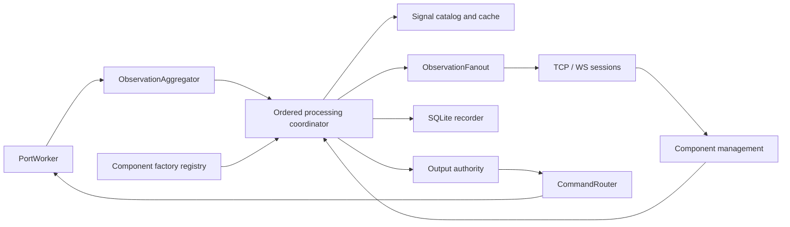

# Processing components

Status: implementation in progress. The user approved option A: worker-originated
source metadata, rejection of old queued generations, automatic filter reinitialization
only from a valid new generation, and explicit operator restart for controllers.
Baseline: `78d150ed484aca8932bbc375bf8c6dc59c64f733`.

## Boundaries

The physical DeviceRegistry remains immutable. A separate dynamic SignalCatalog describes
physical and derived signals. DeviceService owns component instances in RAM; neither a
transport session nor a driver owns a component. Configuration is data (type, identity,
named inputs, parameters, revision), suitable for future TOML loading. There are no
per-component threads, port opens, or legacy runtimes.

## Extensibility and transactions

A ComponentFactory supplies a stable type identifier, kind (filter/controller), typed
parameter schema, named input/output descriptions, validation and construction. A Component
processes samples and invalidation, resets and prepares a replacement configuration while
preserving permitted state. Filters and controllers share graph/lifecycle machinery;
controllers additionally return an optional output proposal, never a hardware command.
The registry is the only location mentioning builtin factories. API, storage, graph,
catalog and client use descriptors and trait objects, without an EMA/PID type switch.

Schemas describe float/integer/boolean/enum parameters, defaults, units and bounds.
Reject unknown fields, nonfinite numbers, incorrect types and cross-field constraint
violations. Validate the entire candidate graph and configuration before commit. Optimistic
expected revisions prevent lost updates. Failed validation leaves configuration, revision,
algorithm state, subscriptions and ownership unchanged. Counters must fail on exhaustion.

Identity includes a never-reused server-local incarnation. Revision is distinct from
incarnation and output ownership generation. Removal/recreation of a name cannot authorize
old commands or attach an old subscription to a new signal silently.

## Graph, catalog and event order

Named input edges reference catalog signals. Validate existence, scalar type, output name
collisions and acyclicity before publication; evaluate in deterministic topological order.
Each source event precedes all of its derived events in cache, fanout and recorder.
Management changes share the coordinator's commit boundary with observations. Publish
catalog registration before first value; invalidate/remove before acknowledging deletion.
Reject deletion with dependents unless an explicit cascade is requested. Cascade first
revokes dependent controller authority, then removes nodes in reverse topological order.

Dynamic catalog membership must reach both describe/get and fanout domains. Domain lineage
is a set of physical source incarnations, not a fabricated physical port. Multi-input
components inherit all source domains. A removed signal terminates affected streams with
an explicit reason; unrelated clients/ports continue. No replay is implied.

## Quality and time

Errors, missing inputs, stale samples, backwards/duplicate timestamps, port stop and loss
invalidate all descendants. An independent monotonic watchdog detects silence; receiving
no event must not leave an Auto controller active indefinitely. Finite numeric validation
also applies to computed outputs. Wall-clock timestamps remain for display/SQLite;
elapsed-time processing and freshness require monotonic acquisition metadata.

Current AggregatorEvent::DataLost is explicitly retrospective: it can arrive after an
affected batch, and equal epoch reads do not certify continuity. Resetting a filter only
at the notification does not establish a trustworthy recovery boundary. The implementation
must resolve this before physical Auto is enabled; see the decision record below.

## Mathematics

EMA initializes from the first valid sample and uses alpha = -expm1(-dt/tau), tau > 0.
Changing tau preserves value and clock; input replacement or invalidation resets history.
PID uses error = setpoint - measurement, derivative on measurement, conditional integral
anti-windup and finite inclusive output bounds. First sample has no I/D increment. Large
gaps invalidate the controller instead of integrating across the gap. Diagnostics are
ordinary signals (error, P, I, D, unconstrained output, bounded output).

## Output authority

Created controllers are shadow-only. Explicit Auto acquisition requires valid fresh input
and a writable target. Manual grants operator writes; Auto grants one controller writes.
Every write uses CommandRouter/PortWorker and a generation checked at the driver's start
boundary. Checking only at enqueue is insufficient. Stop/delete/invalidation revokes queued
generations. An already-started write cannot be cancelled: retain its execution record and
do not grant a conflicting owner until it resolves. outcome_unknown latches a fault;
neither periodic updates nor recovery may automatically retry it.

The authority is algorithm-independent. It validates the calculated finite value against
the target Spec. Integer targets (including furnace1/power) use explicit nearest-integer
rounding, halves away from zero, with range checks both before and after conversion;
out-of-range proposals are rejected, never silently clamped by the adapter.

Generic actions may mutate outputs too. Their admission must participate in ownership;
until effect metadata exists, conservatively reserve the entire device for an action.
Do not infer effects from action names. Safe release means revoking authority and accounting
for in-flight commands; it does not assert that a physical heater has switched off.
A configured safe-output procedure requires a separate explicit contract and confirmation.

## API and client direction

Extend protocol v1 additively with generic type listing, instance listing, create, configure,
delete and controller-state operations. Requests retain monotonic connection IDs and bounded
frames. Configuration mutations carry expected_revision; responses include revision and
incarnation. Type descriptors expose schema and ports. No EMA-only/PID-only network commands.
describe/get/subscribe use the same dynamic catalog on TCP and WS. Steel wrappers should
mirror generic operations and leave scripts/arduino-start.scm unchanged.

Exact wire fields and executable examples will be documented with the implementation;
this design is not a claim that these operations already exist.

The inspected lab-plot baseline is `386459a` on main. Its typed Request enum, encoder,
ResponseData parser, worker matches_request and Steel response conversion all need a
generic management request/result family. Adding only Scheme functions would be insufficient:
the worker rejects responses that do not match the pending typed request. Preserve existing
variants and ACK semantics. New management data should be descriptor-driven JSON converted
to Steel values, without a concrete algorithm switch. Plot bindings already use global
signal keys; dynamic derived signals should follow that path. No client files were changed.

## Archive reference

Reviewed com_port_reader at `1502efb76dcd02eb626bbd6c2e49a047c2f29353`:
`src/signal_processing/filter.rs`, `graph.rs`, `src/process_control/pid.rs`.
Useful behavior: elapsed-time EMA, state-preserving retune, transitive reset/removal,
derivative on measurement and anti-windup. Its central concrete filter enum is not reused.
Reviewed lab-runtime-legacy at `5f357933566fb5cf6c6a7c131d9e149aa1999039`:
`crates/lab-core/src/control.rs`, `output/authority.rs`. Useful separation: algorithm
proposal versus authority, instance/epoch lease validation, ambiguous write latch.
Its runtime, thread management and EMA/PID-specific controller aggregate are not reused.

## Baseline validation (stage 0)

Both working trees were clean. Fetched origin: master `95fec78`, feature `78d150e`,
0 behind / 4 ahead. fmt, check --all-targets, Debug/Release tests and Clippy
--all-targets -- -D warnings passed with CARGO_TARGET_DIR set as documented in README.
Each test profile passed 362 tests. The initial invocation without that environment
variable failed 9 SQLite test setup checks; no source changes were needed.
Rechecked refs, merged --ff-only and pushed master normally. Feature branch retained.
Real METAKON hardware was not tested; writes remain disabled by default. No COM port opened.

Additional baseline verification: 20 concurrent library tests and all 11 aggregator
integration tests passed on each of three repeated runs. `git diff --check` passed.
These validate the existing implementation only, not the proposed processing design.

The fast-forward included these existing commits (no merge commit was created):

| SHA | Change |
| --- | --- |
| `69dbf7b25afb55f3e56dd3fd74ca0d2e57be57f2` | METAKON driver and hardware-free integration tests |
| `1376a5d4c89d89ebf3c4bf56628490937ed46fec` | Read-only trial documentation and protocol decisions |
| `c2f43ca599a9d0d20a1e9077abc8aad03119bf16` | Interframe pause |
| `78d150ed484aca8932bbc375bf8c6dc59c64f733` | Arduino PowerShell launcher |

Branches: [processing-components](https://github.com/alexandervolkov1/lab-server/tree/feature/processing-components),
[retained metakon-5x3-driver](https://github.com/alexandervolkov1/lab-server/tree/feature/metakon-5x3-driver).
Master will not be changed again before review. No PR, tag or release was created.

## Решение, необходимое перед реализацией

Препятствие относится к общему контракту восстановления после потери данных. Это не
невозможность реализовать фильтры: необходимо выбрать, как изменить контракт источника
или ограничить восстановление. Ни один из вариантов ниже пока не реализован.

Факты в текущем коде:

- `src/port_worker.rs`: канал содержит DeviceObservation без номера последовательности,
  поколения непрерывности и монотонного времени измерения. При Full worker отдельно
  увеличивает loss_epoch. Publication gate защищает отправку и увеличение счётчика,
  но агрегатор не получает через этот канал позицию пропуска.
- `src/observation_aggregator.rs`: DataLost явно документирован как уведомление,
  не как граница пропуска. Он может быть выдан перед старым префиксом очереди.
- Существующий тест
  `tests/observation_aggregator.rs::overflow_is_detected_after_drain_coalesces_and_does_not_stop_commands`
  проверяет `[DataLost(epoch=3), Measurement(value=3)]`, хотя потери относятся к более
  поздним измерениям. Это воспроизводимое поведение, а не гипотеза о планировщике.
- Fanout решает задачу доставки завершением затронутой клиентской сессии; серверные
  компоненты должны жить независимо от этой сессии. Переподключение клиента не создаёт
  границу восстановления графа.

Пример: очередь содержит x1, x2; x3 потерян; агрегатор выдаёт DataLost, x1, x2;
затем поступает x4. Если сбросить EMA на DataLost и продолжить на первом успешном
Measurement, фильтр снова накопит состояние на x1/x2 и соединит его с x4 через
неизвестный пропуск. Контроллер также может принять старый префикс за восстановленный
вход. Простая проверка текущего loss_epoch у x4 не позволяет установить, к какому
из ранее полученных образцов относится пропуск. При нескольких потерях и нескольких
сигналах одного порта ситуация сложнее. Уже опубликованные значения нельзя молча
переинтерпретировать как исправленные.

### Вариант A — расширить общий контракт источника (рекомендуется)

Добавить внутренний envelope наблюдения: incarnation источника, sequence каждой попытки
периодического измерения, continuity epoch и монотонное время завершения. Метаданные
создаёт PortWorker; приборные Driver остаются без изменений. Каждое принятое наблюдение
несёт собственное поколение, поэтому старый префикс и данные после пропуска различимы.
Внешний loss counter сохраняется для обнаружения последней потери даже без новых данных.

Граф немедленно отзывает Auto при обнаружении потери, сохраняет порядок сырого префикса
для записи, а переход между поколениями сбрасывает всю зависимую историю до расчёта
нового значения. Запуск Auto после fault требует отдельного явного действия и свежего
входа нового поколения. Watchdog использует монотонное время. Fanout сохраняет прежнюю
семантику terminal loss; дополнительные сведения в API вводятся аддитивно. Для SQLite
нужно явно определить хранение поколения и связей исходных/производных событий и
версионирование схемы, не выдавая новый формат за старую схему.

Это изменение общей инфраструктуры PortWorker → Aggregator → processing → recorder,
а не специальный путь EMA/PID. Проверки должны воспроизвести старую очередь перед
пропуском, несколько потерь, потерю без последующего измерения, переполнение счётчика,
устаревший sample и изоляцию соседнего порта.

### Вариант B — сохранить текущий канал и ограничить восстановление

После DataLost все зависимые компоненты остаются invalid/fault; успешный sample сам
по себе их не восстанавливает. Для возобновления нужна общая операция resynchronize:
под publication gate установить границу и исключить накопленный префикс из расчёта,
не удаляя его из потока recorder; затем ждать нового свежего входа и явно разрешать Auto.
Полный перезапуск сервера также создаёт новую границу. При постоянно заполненной очереди
восстановление может не состояться; без отдельной границы компоненты остаются fault.

Этот вариант сохраняет форму DeviceObservation, но добавляет координацию с worker и
ограничивает семантику восстановления. Для надёжной проверки возраста всё равно требуется
монотонная метка источника либо отдельно согласованная, более слабая wall-clock политика.

Остановка сделана по прямому условию задания «при обнаружении принципиального
архитектурного препятствия остановиться и представить варианты решения». Никаких
частных обходов для EMA/PID, новых сетевых команд или физического Auto пока нет.
