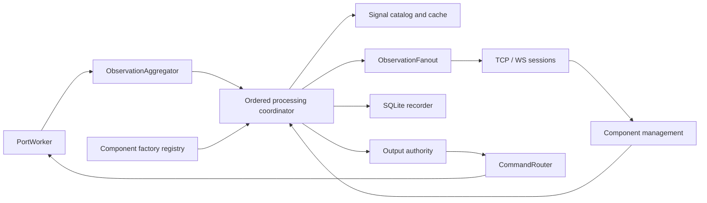

# Processing components

Status: implemented on feature/processing-components; hardware validation and merge pending review.
Baseline: `78d150ed484aca8932bbc375bf8c6dc59c64f733`.

## Boundaries

The physical DeviceRegistry remains immutable. A separate dynamic SignalCatalog describes
physical and derived signals. DeviceService owns component instances in RAM; neither a
transport session nor a driver owns a component. Configuration is data (type, identity,
named inputs, parameters, revision), suitable for future TOML loading. There are no
per-component threads, port opens, or legacy runtimes.

## Extensibility and transactions

A ComponentFactory supplies a stable type identifier, kind (filter/controller), typed
parameter schema, named input/output descriptions, validation and construction. A Component
processes samples, resets on coordinator invalidation and prepares a replacement configuration while
preserving permitted state. Filters and controllers share graph/lifecycle machinery;
controllers additionally return an optional output proposal, never a hardware command.
The registry is the only location mentioning builtin factories. API, storage, graph,
catalog and client use descriptors and trait objects, without an EMA/PID type switch.

Schemas describe float/integer/boolean/enum parameters, defaults, units and bounds.
Reject unknown fields, nonfinite numbers, incorrect types and cross-field constraint
violations. Validate the entire candidate graph and configuration before commit. Optimistic
expected revisions prevent lost updates. Failed validation leaves configuration, revision,
algorithm state, subscriptions and ownership unchanged. Counters must fail on exhaustion.

Identity includes a never-reused server-local incarnation. Revision is distinct from
incarnation and output ownership generation. Removal/recreation of a name cannot authorize
old commands or attach an old subscription to a new signal silently.

## Graph, catalog and event order

Named input edges reference catalog signals. Validate existence, scalar type, output name
collisions and acyclicity before publication; evaluate in deterministic topological order.
Each source event precedes all of its derived events in cache, fanout and recorder.
Management changes share the coordinator's commit boundary with observations. Publish
catalog registration before first value; invalidate/remove before acknowledging deletion.
Reject deletion with dependents unless an explicit cascade is requested. Cascade removes the transitive dependency set and revokes controller authority at
the same service commit boundary, before acknowledging deletion.

Dynamic catalog membership must reach both describe/get and fanout domains. Domain lineage
is a set of physical source incarnations, not a fabricated physical port. Multi-input
components inherit all source domains. A removed signal terminates affected streams with
an explicit reason; unrelated clients/ports continue. No replay is implied.

## Quality and time

Errors, missing inputs, stale samples, backwards/duplicate timestamps, port stop and loss
invalidate all descendants. An independent monotonic watchdog detects silence; receiving
no event must not leave an Auto controller active indefinitely. Finite numeric validation
also applies to computed outputs. The graph carries the oldest contributing acquisition
time across multi-input chains; a fresh trigger cannot hide an aged ancestor. Wall-clock timestamps remain for display/SQLite;
elapsed-time processing and freshness require monotonic acquisition metadata.

Current AggregatorEvent::DataLost is explicitly retrospective: it can arrive after an
affected batch, and equal epoch reads do not certify continuity. Resetting a filter only
at the notification does not establish a trustworthy recovery boundary. The worker envelope and Continuity acceptance floor resolve recovery; see the implementation record below.

## Mathematics

EMA initializes from the first valid sample and uses alpha = -expm1(-dt/tau), tau > 0.
Changing tau preserves value and clock; input replacement or invalidation resets history.
PID uses error = setpoint - measurement, derivative on measurement, conditional integral
anti-windup and finite inclusive output bounds. First sample has no I/D increment. Large
gaps invalidate the controller instead of integrating across the gap. Diagnostics are
ordinary signals (error, P, I, D, unconstrained output, bounded output).

## Output authority

Created controllers are shadow-only. Explicit Auto acquisition requires valid fresh input
and a writable target. Manual grants operator writes; Auto grants one controller writes.
Every write uses CommandRouter/PortWorker and a generation checked at the driver's start
boundary. Checking only at enqueue is insufficient. Stop/delete/invalidation revokes queued
generations. An already-started write cannot be cancelled: retain its execution record and
do not grant a conflicting owner until it resolves. outcome_unknown latches a fault;
neither periodic updates nor recovery may automatically retry it.

The authority is algorithm-independent. It validates the calculated finite value against
the target Spec. Integer targets (including furnace1/power) use explicit nearest-integer
rounding, halves away from zero, with range checks both before and after conversion;
out-of-range proposals are rejected, never silently clamped by the adapter.

Generic actions may mutate outputs too. Their admission must participate in ownership;
until effect metadata exists, conservatively reserve the entire device for an action.
Do not infer effects from action names. Safe release means revoking authority and accounting
for in-flight commands; it does not assert that a physical heater has switched off.
A configured safe-output procedure requires a separate explicit contract and confirmation.
Manual requests remain explicit operator actions after outcome_unknown; automatic authority stays faulted.

## API and client direction

Extend protocol v1 additively with generic type listing, instance listing, create, configure,
delete and controller-state operations. Requests retain monotonic connection IDs and bounded
frames. Configuration mutations carry expected_revision; responses include revision and
incarnation. Type descriptors expose schema and ports. No EMA-only/PID-only network commands.
describe/get/subscribe use the same dynamic catalog on TCP and WS. Steel wrappers should
mirror generic operations and leave scripts/arduino-start.scm unchanged.

The implemented wire fields and executable examples are documented in processing-api.md
and lab-plot/docs/processing.md.

The inspected lab-plot baseline is `386459a` on main. Its typed Request enum, encoder,
ResponseData parser, worker matches_request and Steel response conversion now support a
generic management request/result family. The worker validates the response against the
pending typed request. Existing variants and ACK semantics are preserved. Descriptor-driven
JSON converts to Steel values without a concrete algorithm switch. Plot bindings use global
signal keys for both physical and derived signals. Client changes are isolated on
lab-plot feature/processing-components.

## Archive reference

Reviewed com_port_reader at `1502efb76dcd02eb626bbd6c2e49a047c2f29353`:
`src/signal_processing/filter.rs`, `graph.rs`, `src/process_control/pid.rs`.
Useful behavior: elapsed-time EMA, state-preserving retune, transitive reset/removal,
derivative on measurement and anti-windup. Its central concrete filter enum is not reused.
Reviewed lab-runtime-legacy at `5f357933566fb5cf6c6a7c131d9e149aa1999039`:
`crates/lab-core/src/control.rs`, `output/authority.rs`. Useful separation: algorithm
proposal versus authority, instance/epoch lease validation, ambiguous write latch.
Its runtime, thread management and EMA/PID-specific controller aggregate are not reused.

## Baseline validation (stage 0)

Both working trees were clean. Fetched origin: master `95fec78`, feature `78d150e`,
0 behind / 4 ahead. fmt, check --all-targets, Debug/Release tests and Clippy
--all-targets -- -D warnings passed with CARGO_TARGET_DIR set as documented in README.
Each test profile passed 362 tests. The initial invocation without that environment
variable failed 9 SQLite test setup checks; no source changes were needed.
Rechecked refs, merged --ff-only and pushed master normally. Feature branch retained.
Real METAKON hardware was not tested; writes remain disabled by default. No COM port opened.

Additional baseline verification: 20 concurrent library tests and all 11 aggregator
integration tests passed on each of three repeated runs. `git diff --check` passed.
These validate the existing implementation only, not the proposed processing design.

The fast-forward included these existing commits (no merge commit was created):

| SHA | Change |
| --- | --- |
| `69dbf7b25afb55f3e56dd3fd74ca0d2e57be57f2` | METAKON driver and hardware-free integration tests |
| `1376a5d4c89d89ebf3c4bf56628490937ed46fec` | Read-only trial documentation and protocol decisions |
| `c2f43ca599a9d0d20a1e9077abc8aad03119bf16` | Interframe pause |
| `78d150ed484aca8932bbc375bf8c6dc59c64f733` | Arduino PowerShell launcher |

Branches: [processing-components](https://github.com/alexandervolkov1/lab-server/tree/feature/processing-components),
[retained metakon-5x3-driver](https://github.com/alexandervolkov1/lab-server/tree/feature/metakon-5x3-driver).
Master will not be changed again before review. No PR, tag or release was created.

## Принятый контракт и реализация

Вариант A утверждён пользователем и реализован. PortWorker создаёт SourceMetadata:
source_instance, sequence периодической попытки, generation, acquired_at (Instant),
elapsed от начала worker. Ошибки чтения также являются попытками; пропущенная отправка
увеличивает поколение следующего принятого образца. Агрегатор не восстанавливает метаданные.
Continuity хранит минимально допустимое поколение и отклоняет старый префикс независимо
от позиции DataLost. MAX означает постоянную утрату непрерывности. Старые исходные
измерения сохраняются в recorder, но не восстанавливают граф. Контроллер после потери
остаётся fault до явного shadow и отдельного Auto; фильтр инициализируется новым поколением.

Общие интерфейсы находятся в src/processing.rs: ComponentFactory, Component, Registry,
TypeDescription, ParameterSchema/ParameterType, Configuration, Engine и Management.
В этой версии сигналы компонентов — конечные числовые скаляры, именованные входы и выходы;
параметры поддерживают float/integer/boolean/choice. Kind определяет lifecycle фильтра или
контроллера, proposal указывает выход-кандидат контроллера. Центральный код не знает
конкретных типов EMA/PID. Для нового типа реализуйте factory и Component, зарегистрируйте
его в builtins() (или Registry при самостоятельном использовании Engine), добавьте
математические тесты. Транспорт, recorder и клиент менять не требуется.

prepare/reconfigure возвращает новый объект до commit, а проверки конфигурации и графа
выполняются до изменения RAM. Глобальная revision обеспечивает CAS всех управленческих
изменений. Граф ограничен, порядок детерминирован, каталог вычисляется топологически,
lineage связывает производный сигнал со всеми исходными физическими портами. Общий gate
DeviceService сериализует управление и исходное событие со всеми производными событиями;
recording callback выполняется на этой же границе. Дополнительных runtime/worker потоков
не создано. Watchdog обслуживается существующим startup loop даже при пустом агрегаторе.

Output Authority создаётся в startup и разделяется Managed workers и CommandRouter.
Подробности режимов и проверки issuer/scope описаны в [managed-ports.md](managed-ports.md).
Permit передаётся
в существующий SetExecution и проверяется непосредственно при начале команды PortWorker.
Проверяются поколение владельца, поколения и живость исходных портов, deadline. Последний
ограничен возрастом входа. Atomic source_alive позволяет проверить остановку без повторного
захвата worker stop mutex. У Generic action консервативная область — все writable-выходы
прибора. Controller держит не более одной ожидающей команды; ошибки отзывают authority.

Код и тесты реализации: src/continuity.rs, src/processing/, src/output.rs,
tests/processing.rs, tests/processing_service.rs, тест processing_management в
 tests/websocket.rs, loss_before_old_prefix в src/port_worker/subscription_races.rs.
SQLite v2 включает транзакционную миграцию v1, исходные метаданные и общий record_order.
В lab-plot добавлены typed request/result, Steel wrappers и проверка реального серверного
тракта Arduino driver → EMA → TCP → PlotState с эмуляцией serial I/O в памяти.

Точный сетевой контракт, переходы состояний, ограничения и совместимость описаны в
[processing-api.md](processing-api.md). Примеры Steel находятся в lab-plot/docs/processing.md.
Конфигурации пока RAM-only; data-only Configuration допускает последующий TOML loader.
Физическое оборудование, аппаратные interlock и восстановление COM-порта не проверены.
Автоматического повторного открытия остановившегося порта по-прежнему нет.
